# 实践课1：Pi Agent 安装与基础使用 实验报告
姓名: yangxinhua
学号: 202430224022
GitHub: faw-k123
## 一、实验目的
- 在Windows本地完成Pi coding agent的安装与启动，理解“Pi客户端 + 模型服务”的架构：客户端本身不含大模型，模型能力来自配置的提供商。
- 掌握 `/login` 以API Key方式配置模型提供商，并完成一次最小会话验证。
- 掌握 `/model` 切换模型、`/thinking`（或Shift+Tab）调整思考级别的操作，理解两者分别是“换模型”和“改推理设置”。
- 掌握两类输入方式：@引用代码文件、剪贴板粘贴小图片（Alt+V），验证模型的代码理解与图片识别能力。
- 学会从 Pi Packages 选择并安装插件（Extension），验证重启后加载与实际工具调用。
- （选做）让AI把PPT Skill安装到项目的 .pi/skills/ 目录，完成“安装—发现—调用”三层验证，并用该Skill生成最小PPT。
## 二、实验环境
- 操作系统：Windows 11，Windows PowerShell 5.1
- Node.js：v24.x
- Git：2.47.1.windows.1
- Pi Agent：v1.5.0
- 模型提供商：DeepSeek（API Key方式），使用模型 deepseek-flash、deepseek-v4-pro
- 练习目录：D:\projects\study（即本仓库）
## 三、实验任务与结果
### 任务一：本地安装并启动
在PowerShell中执行官方安装脚本完成安装，关闭旧终端后重新打开，在study目录中启动 pi。
启动时Pi自动补齐依赖工具，部分工具下载超时警告不影响客户端本身。Pi正常启动，显示启动帮助、[skills] 列表和当前工作目录 D:\projects\study，并提示 No models available ——说明客户端已装好，下一步是配置模型。
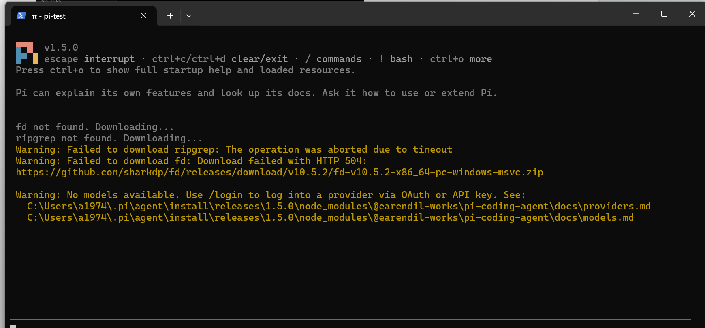
### 任务二：配置模型并完成一次会话
在DeepSeek官方API平台创建密钥后，回到Pi输入 `/login`，选择 Sign in with an API key，提供商选择DeepSeek完成配置（密钥脱敏不截图、不提交 auth.json）。

配置完成后发送提示词 `Hello?`，模型正常回复。底部状态栏显示当前模型 deepseek-v4-pro · thinking off，证明会话链路可用。

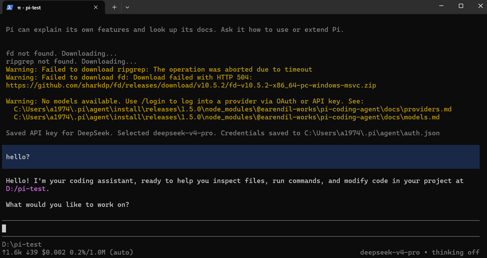
### 任务三：切换模型与模型思考级别
输入 `/thinking` 打开Thinking Level菜单，将级别切换为 high。发送验证指令查看当前thinking level，确认 `PI_REASONING_LEVEL=high`，底部状态栏同步变更，证明切换生效。

模型切换：会话中通过 `/model` 将模型由 hdeepseek-v4-pro 切换为deepseek-flas ，后续任务截图右下角状态栏可见切换结果。体会：思考级别是推理深度的设置而非更换模型；简单问答用默认级别即可，复杂解释、多工具任务用 high，但等待时间与用量随之增加。

### 任务四：@引用代码文件 + 粘贴小图片
A. 使用 @引用代码文件：在练习目录创建 `hello.py`，定义add函数。在Pi输入@，选中hello.py，发送提示词解释代码功能。模型读取文件，解释代码逻辑并给出运行输出。

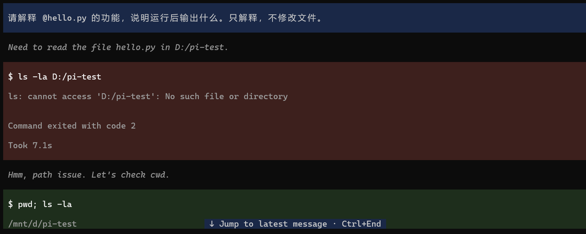
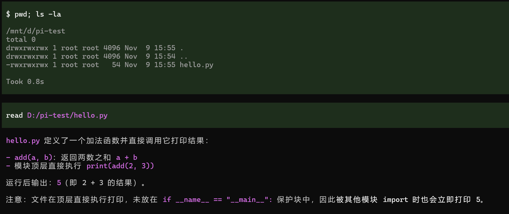

B. 粘贴图片并测试：准备一张图片，在Pi输入区按Alt+V粘贴图片，发送提示词描述图片内容。模型识别图片内颜色、形状、文字，识别结果与原图一致。

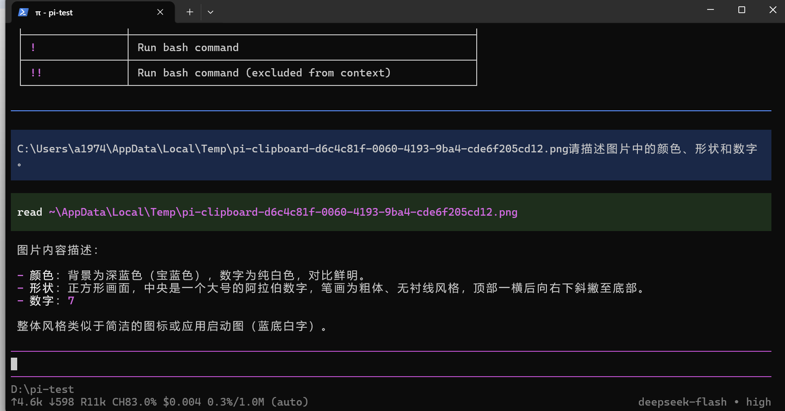

### 任务五：安装并使用一个插件
从 Pi Packages 选用插件 pi-web-access（为模型提供网页抓取工具）。执行个人级安装命令 pi install npm:pi-web-access，输出输出提示安装成功。完全退出原会话并重新运行 pi，启动信息中出现【Extensions】区域并列出 pi-web-access:dist，证明插件已随启动加载。
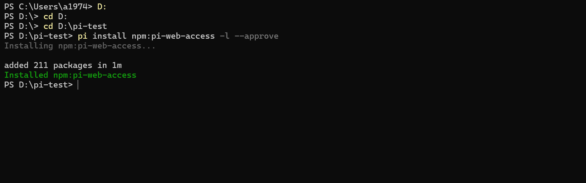
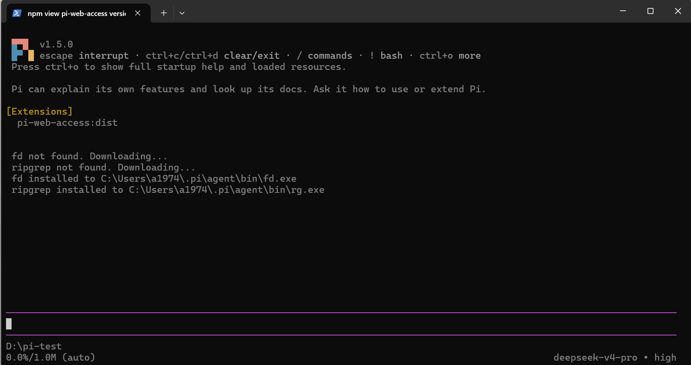
试用最小功能，发送指令抓取网页标题，模型调用插件fetch工具，输出页面标题。加载成功与联网功能可用两个层面均得到验证。
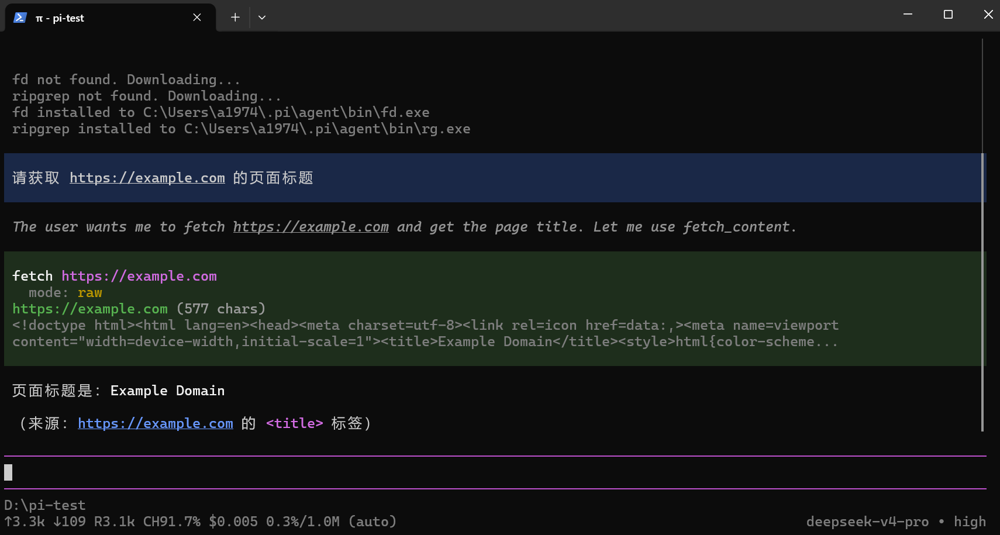

### 任务六：让AI安装PPT Skill
安装：向 Pi 发送提示词，要求从 https://github.com/anthropics/skills 下载 skills/pptx 完整目录安装到当前项目的 .pi/skills/pptx，保留 SKILL.md、LICENSE.txt 与 scripts/ 支持文件，记录源 commit，且不自动安装依赖。AI 完成下载并生成元数据文件 SOURCE.txt（源 commit 2c5958ec…，56 个源文件），报告了目录结构。
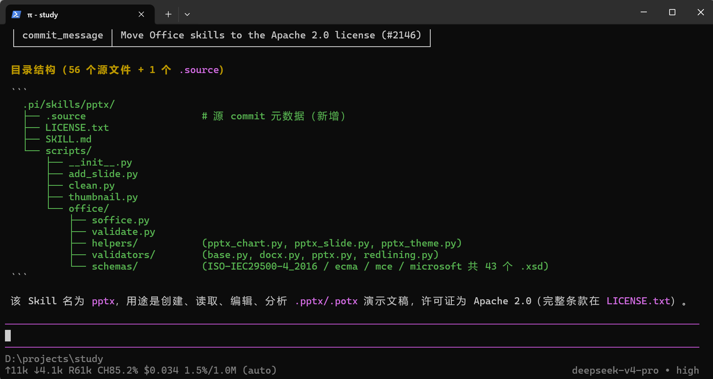
在资源管理器中核对实际目录 D:\projects\study\.pi\skills\pptx，可见 scripts/、LICENSE.txt、SKILL.md、SOURCE.txt，与报告一致。
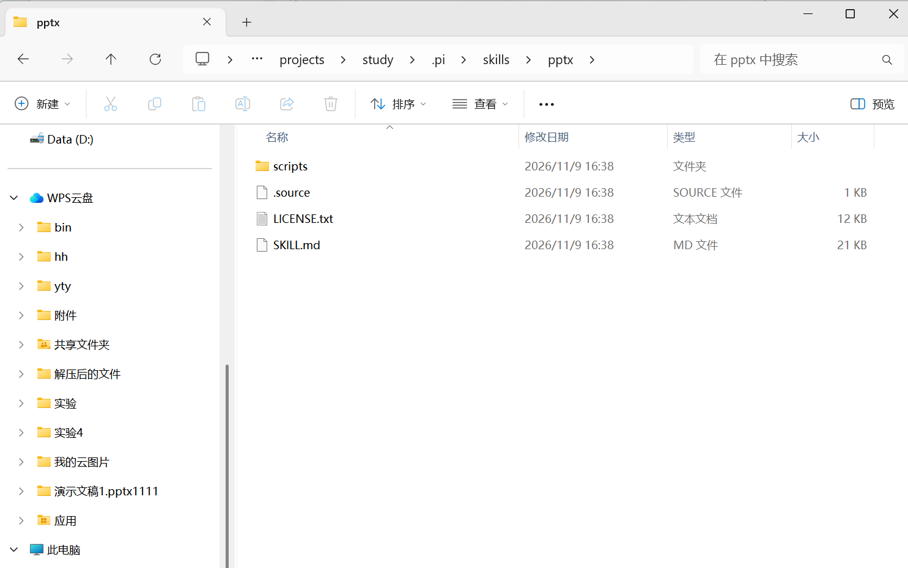
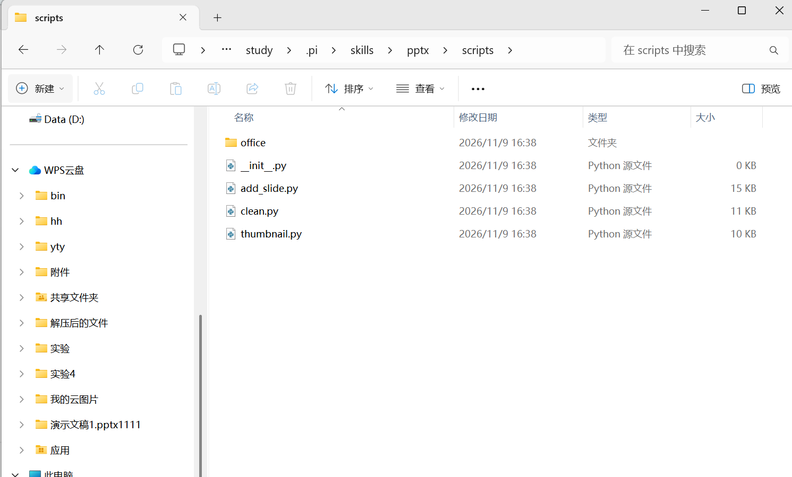
发现：完全退出后重新运行 pi，按 Ctrl+O 查看启动帮助，[Skills] 的 project 区域列出 E:\Project\Source\pi-test\.pi\skills\pptx\SKILL.md，证明重启后被自动发现（同一界面中 [Extensions] 也显示用户级插件 npm:pi-web-access）。
检验skill安装成功
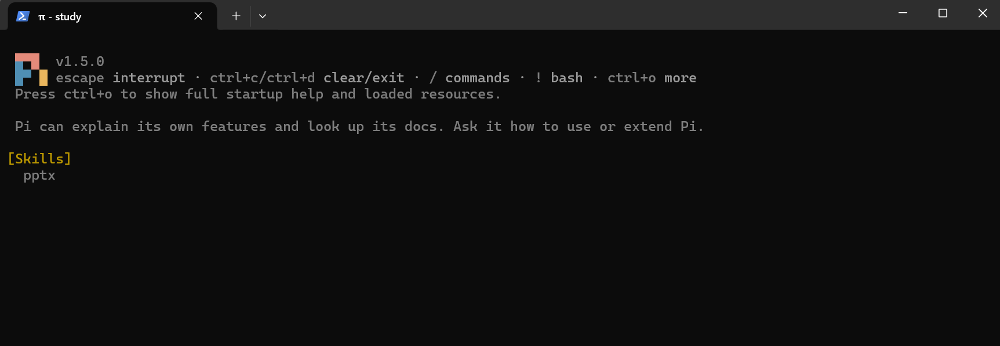
调用：输入 /skill:pptx 请说明这个 Skill 的名称、用途和所在目录，模型基于 Skill 内容回答：名称 pptx，位于 E:\Project\Source\pi-test\.pi\skills\pptx，用于 .pptx 文件的创建、编辑与分析。
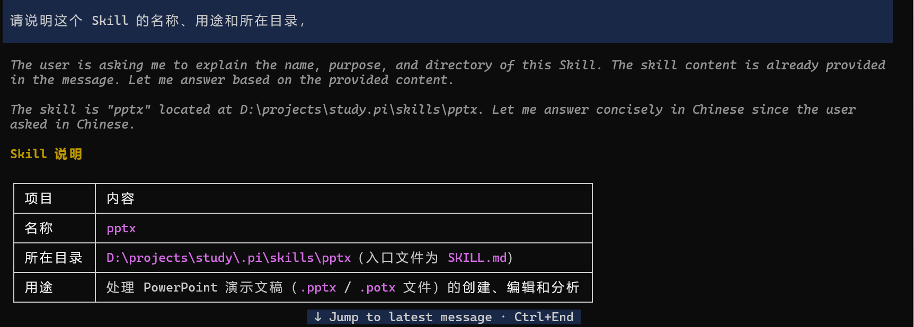
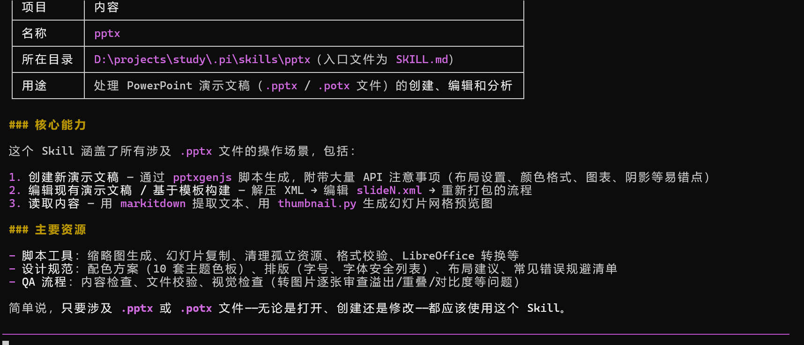
生成 PPT（选做）：让 AI 用该 Skill 生成两页最小 PPT（第一页 Hello, PPTX SKILL!，第二页 Bye!）。过程按 Skill 指引完成：用 pptxgenjs 编写生成脚本（首次 require 失败，npm install pptxgenjs 后正常），validate.py 全部校验通过，并解压 XML 确认两页文本无误；环境差异由 AI 现场绕开（markitdown 未安装改用解压 grep 校验、soffice.py 的 socket.AF_UNIX 在 Windows 不可用改直接调用本机 LibreOffice、本机 pdftoppm 不支持 -jpeg 改用 -png）。产物 output.pptx 与脚本 make_deck.js 已随本仓库提交。
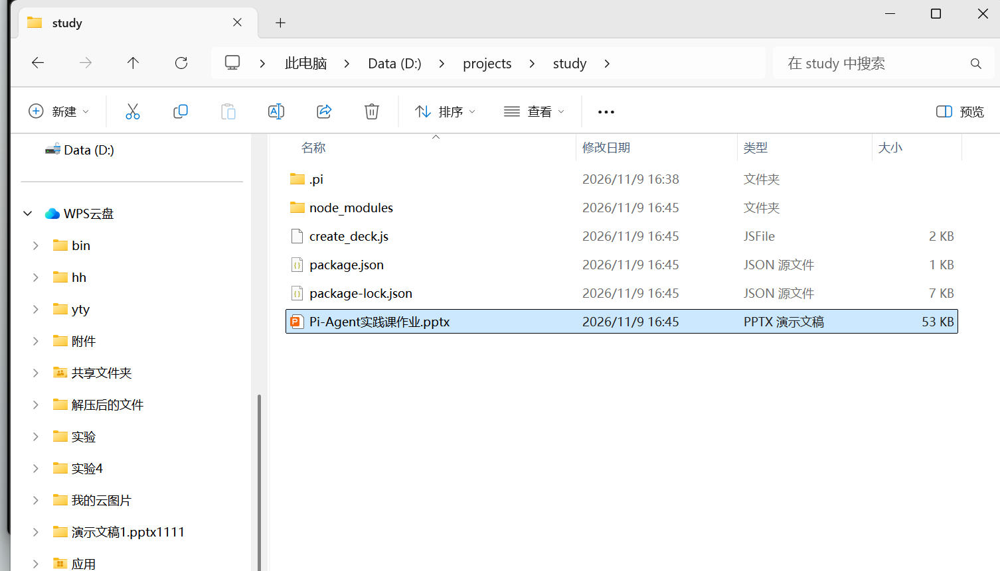

## 四、实验总结
Pi Agent 实验链路复盘
1. 客户端与模型解耦：No models available 不代表安装失败，只说明尚未配置提供商；模型能力、计费均来自 API 提供商，模型名以 /model 当前列表为准。

2. 模型与思考级别是权衡：deepseek-flash 满足日常问答，复杂解释与多工具任务切到 deepseek-v4-pro · high 更稳，但等待时间与 token 用量明显上升。

3. 插件与 Skill 机制不同：Extension 通过 pi install（npm）安装、以工具形式被调用；Skill 是放入 .pi/skills/ 的说明与支持文件目录，重启后被发现、/skill: 显式调用。“安装成功、发现成功、调用成功、产出成功”是四个独立层次，需要分别取证。

4. 网络与环境差异是常态：fd/ripgrep 下载失败不影响主体功能；Skill 文档假设的依赖（markitdown、Unix socket 等）在本机不一定成立，应按实际环境核验后绕行，而不是照搬文档。

5. @ 引用与图片粘贴：让 agent 能“看代码、看图”，配合脱敏意识（不提交密钥、auth.json、授权回调）可以安全地完成日常开发辅助。